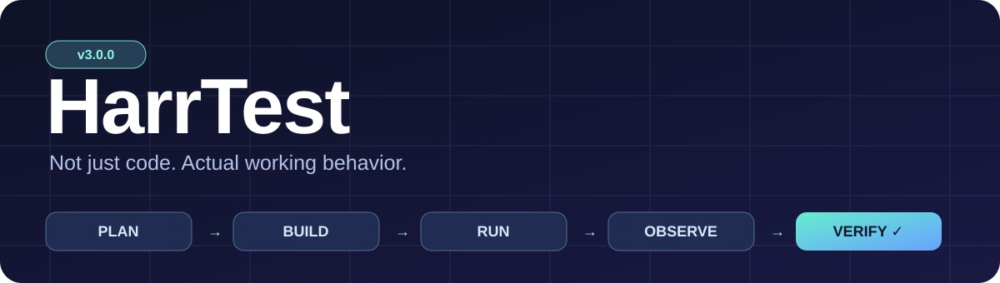
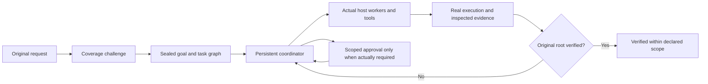

<div align="center">



# HarrTest v3.2

**Original-goal verification + persistent execution coordination for coding agents.**

[](CHANGELOG.md)
[](https://github.com/abdoabozena7/HarrTest/actions/workflows/verify.yml)
[](scripts/workflow.py)
[](LICENSE)

**A worker finishing is not your goal finishing.**

[Install](#install) | [What changed](#what-v3-adds) | [Workflow](references/v3-workflow.md) | [Migration](references/v3-migration.md) | [Validation](references/v3-validation.md)

</div>

## Install

The portable skill ID remains **`harrtest`**. Update the complete skill using your
host's supported skill installation. For the Agent Skills CLI:

```bash
npx skills add https://github.com/abdoabozena7/HarrTest --skill harrtest -g
```

Select the coding agent you actually use. Restart/reload that host's skill discovery,
then ask it to invoke HarrTest and verify the installation. Do not assume a successful
copy proves the skill or stop hook was invoked. New sessions should use v3; don't
silently replace the engine in the middle of an active mission.

A direct project install is also supported by the bundled standard-library installer:

```powershell
py -3 .\scripts\install.py --agent copilot --scope user --project C:\path\to\repo --instructions --hooks --update --dry-run
py -3 .\scripts\install.py --agent copilot --scope user --project C:\path\to\repo --instructions --hooks --update
```

Review the dry run. Existing project instructions are merged and backups retained.
Hooks are optional and host-specific (Copilot CLI/compatible hosts and Claude); no
Codex bridge or extra provider is installed. The skill can be used without hooks,
but then automatic stop enforcement must not be claimed. Read [migration notes](references/v3-migration.md)
before using v3 with old sealed tasks or legacy `prove-it` hooks.

## New in v3.2: Host-native Project Builder

Build a new product in real, running milestones without changing your coding host,
model provider or billing path. The host chooses the architecture and writes code;
HarrTest validates the plan and coordinates its execution/acceptance.

- **Architecture before bulk implementation:** record stack choice, alternatives,
  constraints, interface contracts and early risk probes.
- **Runnable milestone gates:** first vertical slice, incremental integration, final
  delivery; every stage checks its predecessors on current source.
- **Useful resumption:** select the next unfinished stage, preserve delivered work,
  reopen evidence-backed defects, and avoid blind retries after an interruption.
- **Native-host delegation:** choose conflict-free ready tasks only when real delegation
  exists. No pretend agents, mandatory parallelism or extra model client.
- **Local-first verification:** reuse fresh passing checks; rerun failed/stale ones.
  A diagnostic fixture costs no paid model calls, but live-host use still consumes its
  normal resources. No artificial mission time/token cap is introduced.

[Builder commands and migration](references/project-builder.md) | [Validation boundaries](references/v3.2-validation.md)

```text
python scripts/builder.py --project PROJECT bootstrap --goal mission --request-file ORIGINAL_REQUEST.txt
# The coding host drafts architecture, seals actual children/root, and fills the plan.
python scripts/builder.py --project PROJECT init --plan build-plan.json
python scripts/builder.py --project PROJECT next --goal mission
python scripts/builder.py --project PROJECT gate --goal mission --milestone M1
```

Try the actual local HTTP/persistence/clean-package demonstration:

```text
python examples/builder_demo.py --output /path/to/new/disposable-build
```

This is an executable controller test with author-supplied code, not evidence that
an LLM built a complete game autonomously. No live Copilot/model uplift, visual game
quality or continuous overnight execution is claimed.

## What v3 adds

| Capability | Actual implementation | Boundary |
|---|---|---|
| Root-aware completion | Stop callback checks original roots as well as the child | Host must actually invoke the hook; user/host stop remains honored |
| Request coverage | Schema-3 span inventory plus a separately declared reviewer artifact | Structural coverage does not prove natural-language understanding |
| Persistent work | Transactional SQLite registry, ready nodes, worker tokens and renewable leases | Cooperative coordination, not an OS sandbox |
| Conflict control | Read/write-prefix conflicts and exclusive resource ownership | Undeclared/outside writers are not intercepted |
| Safe resumption | Preserve handoffs; expired workers require evidence-backed reconciliation | Expiry does not prove the old process stopped |
| External effects | Stable operation intents; UNKNOWN_EFFECT blocks blind replay | No universal exactly-once guarantee or new permission |
| Context packets | Original goal, focused file hashes, scopes and historical failures | Files must be selected appropriately; no secret environment dump |
| Evidence identities | Collector plus declared check dependencies, not every unrelated helper | Relevant verifier/source changes still invalidate current acceptance |
| Evaluation summaries | Matched-condition checks, all assigned trials, false-success counters | No fabricated model-performance uplift or causal claim |
| Strict parsing | Reject duplicate JSON keys and nonfinite evidence values | Authenticity still requires trusted execution/review |

## The working loop



Use the current host's models, authentication and billing. Native subagents are
chosen for genuinely independent work, not forced on every button fix. The runtime
returns real task packets and coordinates ownership; it does **not** pretend that
writing `worker-1` to a file spawned another agent. See [the runbook](references/v3-workflow.md).

## Use it with a short goal

```text
Use the latest verified harrtest skill. Complete my original project goal,
fix the remaining problems, and verify the real running result. Decide the
steps yourself; preserve existing permissions and acceptance criteria.
Do not call a passing child or a finished session a completed original goal.
```

The agent creates and maintains plans/contracts; users should not need to fill out
JSON manually for ordinary tasks. The package supplies [templates](assets/templates/)
and concrete commands to support that work.

For a new whole-goal contract use schema 3. A distinct real reviewer challenges its
coverage. Legacy schema 2 is still readable and explicitly labelled legacy/self-reviewed
coverage. Do not invent an independent reviewer when none is available.

## Actual runtime adapters

**Web:** real browser interactions, persistence/error recovery, visual inspection.
**API/library:** actual public calls and independently expected effects.
**CLI/code generation:** real prompt/command, then run and evaluate the generated app.
**Simulation:** actual simulator, sensors, measured physical motion and original gates.

Only use tools/permissions the host genuinely provides. Browser tools and Playwright
are optional, separate dependencies; a skill does not install a GPU, CARLA or a
browser. Mock/replay success never certifies a live integration.

## Persistent workflow quick reference

```text
python scripts/workflow.py --project PROJECT init --plan workflow-plan.json
python scripts/workflow.py --project PROJECT ready --goal mission
python scripts/workflow.py --project PROJECT claim --goal mission --task backend --worker ACTUAL_HOST_ID --lease-seconds 600
python scripts/workflow.py --project PROJECT handoff --goal mission --task backend --token TOKEN --evidence .runtime-proof/backend/handoff.md
python scripts/workflow.py --project PROJECT verify --goal mission --task backend
python scripts/workflow.py --project PROJECT root --goal mission
```

These examples require actual sealed children/root and permissions. A lease is a
renewable coordination mechanism, not an artificial mission budget. The agent may
spend longer on useful work, but must honor cancellation, actual host limits and
protected resource policies. Optional consultation failure is not a reason to stop;
mandatory consent is never inferred from silence.

## Reproduce the local verification

```bash
python -B -m unittest discover -s tests -p 'test_*.py' -v
python examples/workflow_demo.py --output /path/to/new/disposable-demo
```

The demo really launches a broken CLI, observes lost persistence across separate
processes, repairs it, reopens the workflow database across commands, blocks child-only
completion, verifies integration, and rejects stale evidence after a source edit.
It is a **local subprocess test**, not a Copilot/model benchmark. See the explicit
[tested/untested boundaries](references/v3-validation.md).

CI exercises Linux and Windows on Python 3.10/3.12 and publishes the full `skill.zip`.
Optional live-browser testing is separate; skipped browser tests are not passes.

## Upgrade without erasing history

Keep old recordings, receipts and root contracts. Legacy all-script seals are not
silently re-stamped as v3 evidence. New v3 checks fingerprint direct skill-command
dependencies automatically; declare further imported verifier files using
`harness_dependencies`. An unrelated release-lookup change need not invalidate a
child, but an actual collector/source/oracle change does. [Migration guide](references/v3-migration.md).

## Honest enterprise boundaries

This release implements the **local reliability core**, not every research roadmap
item. It does not claim independent signed enforcement, automatic LLM planning,
production certification, universal model improvement or uninterrupted execution
when the host stops. A worker with unrestricted access to contracts, code and evidence
can tamper with all three. Consequential deployments need a trusted verifier and
policy outside worker write access.

No new model-provider credentials, remote logging service or paid endpoints are
introduced. Preserve resource limits, safety criteria, holdouts, user files and
secrets. Read [SECURITY.md](SECURITY.md) and [the capability boundaries](references/security-and-limitations.md).

## Evolution and measured impact

Inspired by deterministic workflow control, durable state, scoped coordination and
independent behavioral evaluation. The accompanying research informs the design;
Microsoft/Google code or SDKs are not bundled as mandatory dependencies.

Use `scripts/evaluation.py` on independently evaluated, matched baseline/candidate
runs. It retains missing/blocked outcomes and refuses to equate fixtures with
live-agent evidence. The proposed large held-out model campaign remains future
work, not a claimed result. See [CHANGELOG](CHANGELOG.md) and [CONTRIBUTING](CONTRIBUTING.md).

## Persistent project brief and selective subagent context (v3.1)

HarrTest now keeps private, project-specific state **outside both the target
repository and the replaceable skill installation**, in
`~/.harrtest/projects/<project-name>-<path-hash>/`. Upgrading the skill does not
erase it. The goal is preserved verbatim; architecture notes are bound to source
file hashes and marked stale after edits; child checkpoints remain historical.

```powershell
python scripts/project_memory.py --project C:\path\to\project bootstrap
python scripts/project_memory.py --project C:\path\to\project brief
python scripts/project_memory.py --project C:\path\to\project note --category architecture --text "API routes are implemented in backend/server.py" --source backend/server.py
python scripts/project_memory.py --project C:\path\to\project pack --task "Implement persistence and verify reload" --role implement --budget-chars 12000
```

The `bootstrap` command detects `ROOT_GOAL.md` or `GOAL.md` automatically; pass
`--goal-file` when neither exists. Every task's real `workflow.py claim` packet
includes a selective project-memory pack anchored to the original sealed root.
The pack contains relevant paths, source-qualified facts and last checkpoints,
**not a dump of the repository or all conversation history**. Optional curation by
an already-available stronger host model may select note IDs; deterministic
validation enforces goal, task, role and source freshness. HarrTest never launches
or charges another model secretly. See
[the complete memory workflow](references/project-context-memory.md).
