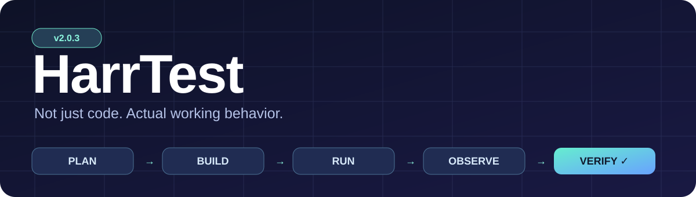
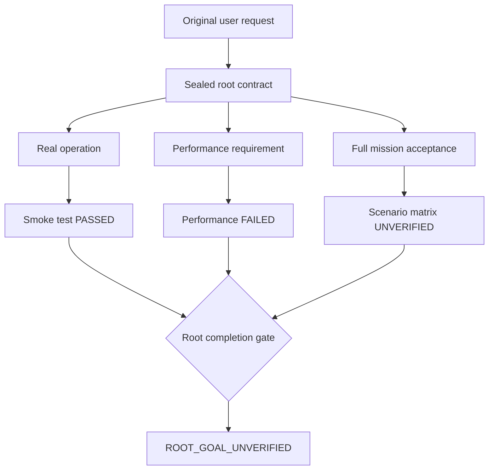
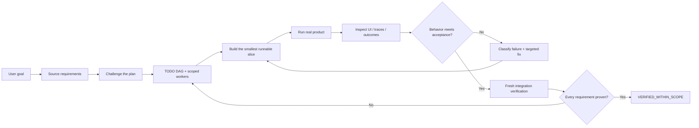
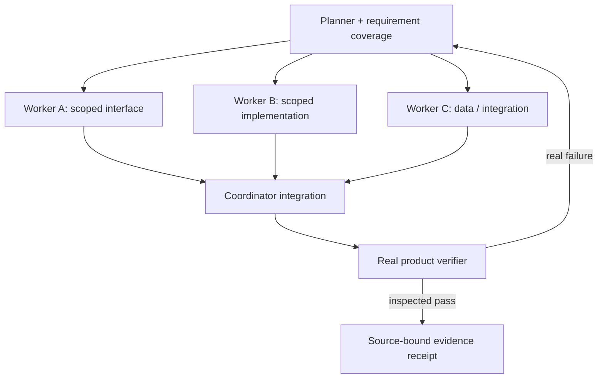

<div align="center">



# HarrTest · HarrTest

**A tool-first, evidence-first skill for autonomous coding agents.**  
**HarrTest** is the public standalone repository for the **HarrTest** skill (`harrtest`).

[](CHANGELOG.md)
[](https://agentskills.io)
[](scripts/proof.py)
[](LICENSE)
[](https://github.com/abdoabozena7/HarrTest/actions/workflows/verify.yml)

**Plan it. Run it. Test the real thing.**

[Quick install](#-install) · [How it works](#-the-verification-loop) · [Use cases](#-what-it-checks) · [Safety](#-important-limitations) · [Versions](CHANGELOG.md)

</div>

---

## ⚡ Install

> **Official repository:** `abdoabozena7/HarrTest`. The `SKILL.md` is at the repository root and the installable skill identifier stays `harrtest`. Installing the skill is **not** the same as enabling optional project-level stop hooks.

```bash
# Install in the current project from the canonical public repository
npx skills add https://github.com/abdoabozena7/HarrTest --skill harrtest

# Or, to choose from all supported coding-agent integrations
npx skills add https://github.com/abdoabozena7/HarrTest

# Verify what was installed
npx skills list
```

Requires Node.js 22.20+ for the current skills CLI. Check `npx skills --help` for supported agents and unattended options. To install globally, pass `-g` and explicitly choose the supported agent if needed. To install from a local clone of this repository instead:

```bash
npx skills add ./HarrTest
```

### Dedicated optional enforcement harness

The portable `SKILL.md` works as instructions. To enable deterministic local evidence receipts and optional stop hooks, review the included Python tools, then run the installer's dry-run first:

```powershell
# From the unzipped skill folder:
py -3 .\scripts\install.py --agent copilot --scope user --project C:\path\to\your\repo --instructions --hooks --dry-run
py -3 .\scripts\install.py --agent copilot --scope user --project C:\path\to\your\repo --instructions --hooks
```

`--agent codex`, `--agent claude`, or `--agent generic` are supported for instructions/install; hooks only for Copilot and Claude where supported. The installer preserves existing instructions and backs up modified files; validate host-specific hook support in your actual client. Read [security boundaries](SECURITY.md) first.

## Root goal integrity — new in v2

A passing smoke test is **not** the same as completed original user requirements. HarrTest now distinguishes a passing **child** receipt from a separately sealed **root** contract.



Use `scripts/root_gate.py init` to preserve the exact original request, populate a source-anchored `root-contract.json`, seal it **before** child execution, and verify the complete goal with `root_gate.py verify`. See [root-goal runbook](references/root-goal.md). A successful `proof.py verify` only means **CHILD_TASK_ONLY**. Scope coverage still needs a meaningful independent review; no model-authored test can guarantee global correctness.

## 🔄 The verification loop



A green unit-test suite, a passing commit, a worker saying “done”, or a screenshot file no one inspected **does not** prove the user's requested outcome.

## 🧠 Hivo-inspired, but agent-agnostic

| Mechanism | What it prevents | Output |
|:--|:--|:--|
| **Requirement ledger** | User goals disappearing during decomposition | Stable `REQ-*` IDs + original-source provenance |
| **Impact challenger** | Perfectly executed but incomplete plans | Reviewed change/preserve/test ownership |
| **Context sufficiency** | Workers guessing APIs and editing wrong files | Targeted repository facts before mutation |
| **Adaptive task DAG** | Monolithic prompts and pointless agent proliferation | Serial / hybrid / real subagent missions |
| **Failure taxonomy** | Repeated ineffective attempts | Falsifiable next experiments |
| **Verified memory** | Outdated "it worked" claims crossing revisions | Durable constraints vs source-bound facts |
| **Runtime acceptance** | Unit-test theater and mocked success | Inspected browser/simulator/CLI behavior |

The architecture is inspired by techniques explored in [Mini Hivo](https://github.com/abdoabozena7/mini_hivo); it does not import Mini Hivo's pinned model or claim its experimental results have universal validity. See [the detailed adaptation](references/hivo-patterns.md).

## 🧪 What it checks

| Project | Real interaction required | Proof to collect |
|:--|:--|:--|
| **Front-end / UI** | Start app; click buttons, type, resize, reload, test failures | Rendered screenshots + browser traces + state/network outcomes |
| **Back-end / API** | Call actual public API; verify persistence/error handling | Status/response/state changes and negative cases |
| **Simulation / CARLA** | Start authorized native engine, tick physics, observe ego/sensors and full required runs | Live run IDs, measured motion, video, collision/route metrics |
| **Mini Hivo / CLI agents** | Submit a real prompt through the actual CLI; execute generated artifact | Worker/tool trace + evaluated output behavior |
| **ML workflow** | Execute supported inference/training/validation path when authorized | Measured outputs; distinguish model, rendering, simulation and replay |



Subagents are **optional**. Use them only when your host actually supports delegation and tasks are independent. Otherwise execute the same DAG serially.

## ✅ Honest completion states

```text
TODO  →  IN_PROGRESS  →  IMPLEMENTED  →  VERIFIED
                  ↘ BLOCKED_UNVERIFIED ↗
```

`IMPLEMENTED` ≠ `VERIFIED`. A completed subagent ≠ completed user goal. Every verified item needs current-source evidence and an integrated user-journey check. The final report must say `VERIFIED_WITHIN_SCOPE`, `PARTIAL`, `FAILED`, or `BLOCKED_UNVERIFIED`.

## 🧰 What's in the box?

```text
HarrTest/                   # repository root / one skill
├── SKILL.md                      # universal agent instructions
├── references/
│   ├── hivo-patterns.md          # better planning, recovery and memory
│   ├── planning-and-delegation.md
│   ├── acceptance-and-test-quality.md
│   ├── web-validation.md
│   ├── simulation-validation.md
│   └── cli-agent-validation.md
├── scripts/
│   ├── proof.py                  # local evidence receipts + gate
│   ├── planning.py               # DAG validation
│   ├── browser_probe.py          # optional real browser journey runner
│   └── install.py                # install, instructions, optional hooks
├── assets/templates/             # mission and evidence templates
├── tests/                        # harness regression tests
├── examples/                     # disposable demos
├── CHANGELOG.md                  # v1 → future updates
├── SECURITY.md
└── visual/banner.svg
```

## ▶️ A practical invocation

Use this in your coding agent after installation:

```text
Use harrtest for this task.
1. Capture the original user requirements and build a dependency-aware TODO plan.
2. Challenge omissions before touching implementation; select real subagents only if useful.
3. Execute the actual product in its real environment; collect and inspect evidence.
4. Classify failures; repair the smallest valid cause and rerun.
5. Integrate all branches/workers and verify the original journeys on final code.
6. Do not claim completion without current evidence and an honest final status.

Task: [your actual coding task]
```

For a source-bound local evidence contract, read [the harness guide](references/harness-guide.md) and call `python scripts/proof.py --help`. Optional browser probes use Playwright installed separately: `python -m pip install playwright && python -m playwright install chromium`.

## 🔒 Bounded autonomy and recovery (v2.1)

For native simulation, paid compute, deployments, browser integrations and
other resource-gated tasks, separate **explicit user authorization**, actual
host/ownership admission, resource arithmetic, protected budgets, and root
acceptance. A passing offline check cannot close the original root goal.

```text
User goal → Scoped approval? → Read-only resource precheck
                       │                    │
                  No: precise         Host's REAL gate
                  approval request     ├── Denied: diagnose/recover
                                       └── Granted: next original gate
```

`python scripts/admission.py intent.json policy.json` checks only supplied
metadata and arithmetic; it never grants permission or mutates a budget. A
successful check explicitly returns `PRECHECK_OK_NOT_AUTHORIZED` because
approval provenance and real resource ownership must be independently
verified. Do not hardcode CARLA's numerical limits as universal rules.

Read [the autonomy guide](references/autonomy-and-admission.md) for a portable
failure-to-prevention protocol and examples.

## 🛡️ Important limitations

This is a **skill, not a universal agent runtime**. It cannot create browser access, GPU access, credentials, external service permissions, infinite background work, or unlimited budgets. It does not turn mocked data into native simulation evidence. The evidence gate checks declared contracts and current artifacts, **not mathematical correctness** of a self-authored oracle. A stop hook can request continuation but cannot defeat user stops or host execution limits.

Never bypass research holdout restrictions, experiment budgets, sandbox policies, protected files or safety controls to obtain a green result. Screenshots and traces can expose secrets; keep runtime evidence out of public Git commits. Full boundaries: [SECURITY.md](SECURITY.md) · [skill rules](SKILL.md).

## 🔁 Migrating existing installations

The internal skill ID is now `harrtest` (previously `harrnist`, `oh-my-harness`, and `prove-it`). Updating the GitHub URL does not automatically migrate older per-project instruction blocks, old skill folders, or stop hooks. Review and remove the previous skill and its managed hook after validating the new installation; **do not leave two stop hooks targeting different versions active**. For previous `harrnist`, `oh-my-harness` or `prove-it` installations, check `.github/copilot-instructions.md`, `.github/hooks/`, and your personal skill folder. Make a backup before editing; do not delete unrelated hooks or instructions. The existing `.runtime-proof/` evidence and sealed contracts remain intact.

## 🗓️ Versioning and updates

**v1.0.0** = first distributable public baseline, now in the dedicated `HarrTest` repository. Future versions follow semantic versioning and should include a tested [CHANGELOG](CHANGELOG.md), a reproducible `skill.zip` and explicit limitations. Use `npx skills check` / `npx skills update` for supported installs; project-level hooks need separate review when version changes.

## 🤝 Contributions

Ideas and fixes are welcome: propose a real failure case and a measurable verification improvement. See [CONTRIBUTING.md](CONTRIBUTING.md). Licensed under [MIT](LICENSE).

<div align="center"><sub>Built for agents that demonstrate results instead of merely reporting progress.</sub></div>

## Experiment economy and strict acceptance (v2.2)

When a test has a fixed startup/cleanup reserve, distinguish the official
minimum from an agent-chosen preferred duration and the shortest experiment
that still answers the **unchanged** original question. The new read-only
`scripts/experiment_budget.py` proposes a candidate but never authorizes it.

When p95/p99 pass but even one original zero-late requirement fails, the
`scripts/strict_gates.py` helper reports failure. Preserve all samples,
original oracles and complete product evidence. See
[experiment economy](references/experiment-economy.md).


## Behavioral evidence integrity (v2.3)

The optional `scripts/goal_guard.py` audits structured action outcomes against ordered, same-run journeys and hashes. It rejects contradictory PASS, tampered/stale or missing evidence, and an incomplete new run inheriting old success. `scripts/browser_probe.py` now supports `capture_text`, `expect_text_same`, `expect_text_changed` and `wait_ms` so a timer can pass Pause but fail Resume correctly. Root requirements must still pass the separate sealed `root_gate.py`; typed evidence is not an oracle for product truth. See [verification guide](references/goal-verification.md) and [timer journey](examples/timer-journey.json).

## Latest-only preflight and safe continuity (v2.4)

The read-only `python scripts/version_guard.py --installed PATH_TO_HARRTEST`
compares every installed skill file with the current public GitHub main tree,
including Git blob hashes, and accepts explainable CRLF normalization only.
It does not install updates or prove the host invoked the skill. In a
latest-only session, any missing/modified file or unavailable GitHub check
means stop before doing project work. Confirm a separate genuine host
`harrtest` invocation as well.

[Continuing an existing task safely](references/continuation-integrity.md)
explains how to preserve an unfinished task owned by another session, why
source manifests and telemetry populations can have different scopes, and
how to compare real goal improvements instead of simply counting tests.
Use the [controlled evaluation template](assets/templates/skill-evaluation.json)
for baseline-vs-HarrTest measurement; a single unpaired project run cannot
establish that a new version improved outcomes.
