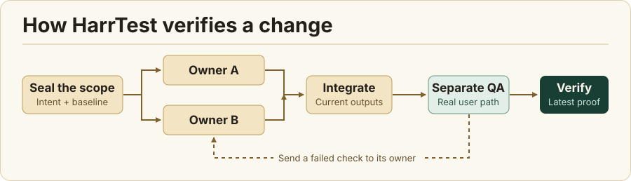
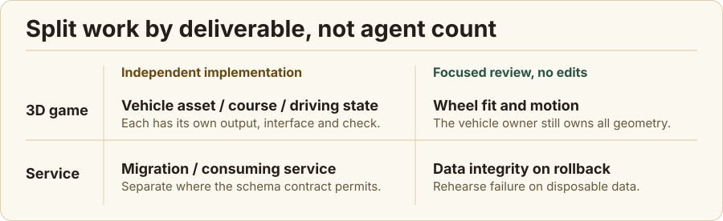
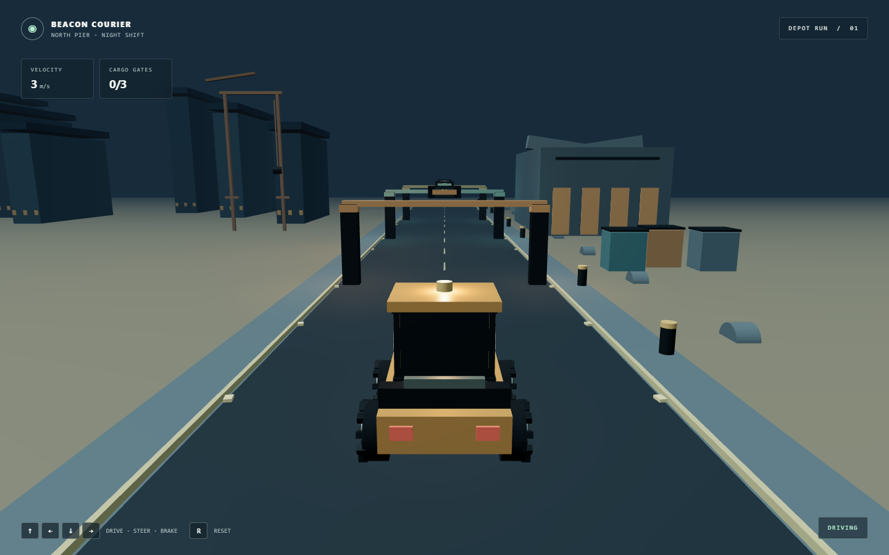

# HarrTest 5

HarrTest is one installable coding-agent skill: **`harrtest`**. The Corporate
workflow is part of version 5, not a separate skill or edition. It starts with
the existing project's architecture, contracts, and measured baseline. It
assigns independent changes to native implementation owners and uses separate
QA to verify the integrated result on current source.

The 5.1 preview adds a scoped
[Feature Preservation Contract and Completion Ledger](references/feature-preservation-and-completion.md).
HarrTest replays relevant old behavior, keeps unresolved destructive decisions
scoped, and refuses verified completion while mandatory work or evidence is open.

**Preview, not a qualified stable release.** See the
[validation record](references/v5-validation.md) for measured results and limits.

[How it works](#how-it-works) · [Luna/low example](#beacon-courier) ·
[Install](#install) · [Try it in two chats](references/two-chat-trial.md) ·
[Start a task](#start-a-task) ·
[Corporate workflow](references/corporate-workflow.md) ·
[Changelog](CHANGELOG.md)

## How it works



For an existing system, agree on what must stay unchanged before anyone
edits it. For a new product, agree on what distinguishes a finished result
from a working placeholder. In both cases the independent reviewer checks
the integrated result, not the implementer's description.



The test for another owner is a distinct deliverable, disjoint writes, a
stable interface and its own check. It should improve the handoff or the
evidence, not just divide a file. If another writer would fragment an asset or
data invariant, keep ownership together and review the specific risk.
For example, a migration and its consuming service can have distinct owners
when their schema boundary is stable, while a reviewer rehearses rollback.

For visual work, the [detail review](references/production-teams.md#require-review-of-specific-details)
lists the required checks before implementation. Each one needs an observed
result with current evidence. A good overall screenshot or a passing runtime
check can't close an omitted detail.

## Beacon Courier

The same small 3D game request went to GitHub Copilot **GPT-6 Luna, low effort**
in both arms. These are unedited gameplay captures about 2.4 seconds into
the same keyboard action, in Edge at 1440 × 900 with SwiftShader.

**Without HarrTest** — one implementation with a straight route, a block-style
rover and clear speed and progress indicators.



**With the HarrTest 5 candidate** — individually numbered gates and warm route
lamps, with separate foreground depot and distant coastal silhouettes. The
chase view shows a smaller rover with more visible chassis and cabin detail.


| Same independent browser check | Without HarrTest | With HarrTest 5 |
| --- | --- | --- |
| Three ordered gates and finish (target: 4–25 s) | 23.661 s | 7.053 s |
| Braking, reset, and driving again | Observed | Observed |

The V5 result used seven native implementation owners, at most two at
a time. Wheel fit and animation stayed with the rover owner, rather than
creating several writers for the same asset. The coordinator assembled those
handoffs. The native Team replay verified ownership, overlap and independent
QA on the integrated result.

The V5 arm used operator-assisted planning and continued after its first
timebox. Its first QA used the wrong rendering backend and did not pass.
After reconnecting, a fresh independent QA worker verified two full runs on
SwiftShader without editing the game. Both the failed and passing reviews
are retained.
This is a development example, not a cold or cost-matched comparison, a
performance benchmark, or release qualification. See the [method and retained
attempts](references/v5-validation.md#beacon-courier-visual-development).
The [historical 4.1 comparison](references/v4.1-validation.md) is a separate
experiment ([plain frame](visual/comparison/without-harrtest.png) ·
[4.1 frame](visual/comparison/with-harrtest.png)).

## Install

Download the single installable [`skill.zip` for HarrTest 5.1 Preview](https://github.com/abdoabozena7/HarrTest/releases/download/v5.1.0-rc.1/skill.zip).
Extract it to get the `harrtest` folder, including its Python 3.10+ scripts
and references. If you already use HarrTest, update your existing installation
instead of adding a second copy.

To hand this to an agent, point it to the [5.1 Preview release](https://github.com/abdoabozena7/HarrTest/releases/tag/v5.1.0-rc.1)
and ask it to install the `harrtest` skill for the current project, confirm it
loaded that copy, and use it for the next task. Reload skill discovery or open
a fresh chat if the host does not pick it up in the current session.

To install from `main` with the Agent Skills CLI:

```bash
npx skills add https://github.com/abdoabozena7/HarrTest --skill harrtest
```

For a project-scoped Copilot install on Windows, run from the target project
using the bundled installer from the extracted folder:

```powershell
py -3 C:\path\to\harrtest\scripts\install.py --agent copilot --scope project --project . --update --dry-run
py -3 C:\path\to\harrtest\scripts\install.py --agent copilot --scope project --project . --update
```

Review the dry run before installing. Reload skill discovery and confirm
that your host loaded the project copy with `VERSION` set to `5.1.0`. Use the
release tag or its asset digest to identify the preview build. Keep active
missions pinned to the build that sealed their contracts. Optional instructions
and hooks are described in the [workflow guide](references/corporate-workflow.md).

## Start a task

Give your host the original task and invoke the skill:

```text
$harrtest
[your original request]
```

Use the [Corporate workflow](references/corporate-workflow.md) for substantial
existing-code changes and [production teams](references/production-teams.md)
for scoped native handoffs. The agent creates and maintains the preservation
contract and ledger; users do not need to author state files. Resume by the same
goal ID and inspect current source before relying on old evidence.
Independently check functionality, preservation,
architecture, security, performance and resilience as applicable. A required
check without evidence stays unverified; an aggregate score does not waive it.

## Compatibility and project tools

- Existing v3 and Gold workflows retain their contract and evidence history.
  Keep old seals and receipts when upgrading.
  [Migration](references/v3-migration.md) · [Gold runbook](references/v4-gold.md) · [4.1 results](references/v4.1-validation.md)
- [Project Builder](references/project-builder.md) coordinates and verifies
  runnable milestones for a new product.
- [Project Memory](references/project-context-memory.md) keeps source-qualified
  facts, mission evidence and task context outside installed skill files.
- [CI](https://github.com/abdoabozena7/HarrTest/actions/workflows/verify.yml)
  exercises Windows and Linux and packages the skill.

Run the regression suite from the repository:

```bash
python -B -m unittest discover -s tests -p 'test_*.py' -v
```

## Trust boundaries

HarrTest verifies declared evidence; it does not sandbox agents, grant
permissions, or guarantee an independent evaluator. Keep production acceptance
evidence outside implementer write access. See [Security](SECURITY.md) and
[capability boundaries](references/security-and-limitations.md).

[Contributing](CONTRIBUTING.md) · [MIT license](LICENSE)
